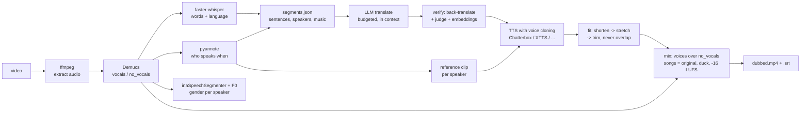

# dubber

Free, local AI video dubbing. Give it a video and a language, get the same video back with every
speaker talking in that language, in their own voice, over the original music. Songs are left alone.

```bash
python dubber.py input.mp4 --to hi --out dubbed.mp4
```

> **Demo video: coming.** It will sit right here: original on the left, dubbed on the right, with a
> two-speaker scene and a song section that passes through untouched.

**About this project.** During an internship I worked on a production dubbing pipeline. This is a
from-scratch rebuild of the *idea* as a portfolio project: none of that company's code, data, prompts
or videos are used here. Every line was written for this repo, and every clip in it is either
synthetic, public domain, or recorded with the speakers' consent. It is non-commercial: some of the
models it can use carry non-commercial licences (listed below), and I have not tried to make money
from it.

It is also not "as good as the commercial products". It is a solid, honest pipeline that runs on a
gaming GPU for zero dollars, and the numbers below are the real ones.

---

## What it does, in one picture



Every stage writes to `.cache/work/<video>/`, and `segments.json` in there is the single source of truth.
If a crash happens, the next run picks up where it stopped. If the pipeline gets a name wrong or
mis-hears a line, open `segments.json`, fix the text or the translation, run again, and only that
segment is redone.

## Quick start (Windows)

You need Python 3.10, ffmpeg on `PATH` (a full build with `rubberband` and `loudnorm`), an NVIDIA GPU
with about 6 GB free (or `--cpu`, which is slow but works), and two free accounts: Hugging Face
(for the gated speaker-diarization model) and a FreeLLMAPI proxy (for translation).

```powershell
.\setup.ps1 -Engines chatterbox        # main venv + the primary TTS engine in its own venv
copy .env.example .env                 # then fill it in, see below
python tests\make_test_clip.py --single   # builds input\clip.mp4 and input\clip_single.mp4
python dubber.py input\clip_single.mp4 --to hi
```

Drop your own videos in `input/`; dubs land in `output/` as `<name>_<lang>.mp4` plus an `.srt`.

`.env` needs three things, names only in `.env.example`:

| key | what |
|---|---|
| `DUBBER_LLM_BASE_URL` | your OpenAI-compatible `/v1`. I run [FreeLLMAPI](https://github.com/tashfeenahmed/freellmapi) locally; it spreads calls over free tiers of many providers. |
| `DUBBER_LLM_KEY` | the proxy's key |
| `HF_TOKEN` | a **fine-grained** Hugging Face token with only *"Read access to contents of all public gated repos you can access"*. First accept the conditions on [pyannote/speaker-diarization-community-1](https://huggingface.co/pyannote/speaker-diarization-community-1). |

Only text ever goes to the LLM, never audio or video. Free-tier providers may log prompts; don't dub
anything confidential through them.

Useful flags: `--keep-original-audio` (adds the original as a second track), `--glossary names.txt`
(one term per line, `Term` or `Term=Translation`), `--num-speakers 2`, `--source-lang en` (skip
detection), `--from translate` / `--only mix` (force or isolate a stage), `--cpu`.

## Why these models

I checked each model's licence on its own card on **2026-10-18** before picking it.

| job | model | licence | why |
|---|---|---|---|
| separation | Demucs `htdemucs` | MIT | still the best free vocals/accompaniment split; the `no_vocals` stem becomes the bed of the final mix |
| transcription | faster-whisper `large-v3` (GPU) / `distil-large-v3` (CPU) | MIT | word timestamps, 99 languages, int8/fp16 on CTranslate2 |
| who speaks when | pyannote.audio 4 + `speaker-diarization-community-1` | MIT code, CC-BY-4.0 weights (gated, free token) | measurably better speaker counting than the 3.1 pipeline; the `exclusive` output aligns cleanly with word timestamps |
| gender | inaSpeechSegmenter + median F0 (librosa pyin) | MIT | ina is French-trained, so it is cross-checked with pitch; disagreement lowers confidence and the pipeline then trusts the voice clone alone |
| meaning check | `paraphrase-multilingual-MiniLM-L12-v2` | Apache-2.0 | small, local, covers all target languages; cosine similarity between original and back-translation |
| translation | your LLM via FreeLLMAPI | n/a | one strong model pinned per run so style stays consistent (`nemotron-3-ultra-550b` on the free NVIDIA route at the time of writing); `auto:fast` for the cheap back-translation |
| **TTS, primary** | **Chatterbox Multilingual v3** | **MIT** | zero-shot cloning, 23 languages, best speaker similarity in my benchmark, the only free engine with Malay. Every output carries Resemble's PerTh watermark; I keep it. |
| TTS, fallback | XTTS-v2 via `coqui-tts` | **Coqui Public Model License (non-commercial)** | fast, good cloning for hi/ja/zh and 14 other languages |
| TTS, fallback | OpenVoice V2 + MeloTTS | MIT | light, fast, tone-colour transfer only; en es fr zh ja ko |
| TTS, bench only | F5-TTS | code MIT, weights **CC-BY-NC-4.0** | zh and en only; strong voice, but it mis-paces when the reference clip is in another language |
| TTS, last resort | Piper | **GPL-3.0** code, MIT voices | no cloning, runs on CPU in a second; this is what `--cpu` uses |

Engines that pin incompatible library versions live in their own virtualenv under `.envs/` and are
driven through a small subprocess runner, so one `pip` conflict never takes the pipeline down.
Which engine handles which language is a table in `dubber/config.py`.

## The two ideas that matter

**Duration budget.** A dubbed line has to fit the slot the original line occupied. Before translating
I compute a character budget from the slot length and a per-language speaking rate (measured from the
TTS itself: Hindi about 15 chars/s, Japanese 7.5, Mandarin 5.2). The translator gets the whole
transcript for context, the glossary, the speaker's gender, and that budget as a *target*. An early
version treated it as a hard limit and the Hindi came out telegraphic: nouns without verbs, meaning
technically there, flow gone. A fluent Hindi speaker caught it in review; the automatic judge had not.
The fix was to make fluency the first rule, let lines run up to ~20 % over, and absorb the rest with
up to 15 % tempo stretch in the fit stage. Only after that do we shorten by rewording, and a shortened
line has to pass the judge again or it is thrown away.

**Verification loop.** Each translation is back-translated to the source language by a cheap model,
then a stronger model judges three things: meaning preserved (0–1), fluency of the target text as
spoken dialogue (0–1, and telegraphic style scores 0.4), and a one-sentence issue. Embedding
similarity between the original and the back-translation is the third vote. A line passes at judge
≥ 0.7, fluency ≥ 0.7, similarity ≥ 0.75; otherwise it is re-translated with the judge's complaint
attached, up to three times, then flagged in `report.json`. Hand-edited translations are never
touched.

Timing fit, for the record: place each clip at its original start sample (so drift cannot
accumulate), allow it to spill at most 0.5 s into the silence after it but never into the next line,
stretch with rubberband up to 1.15× quietly and up to 1.25× with a flag, and if it still does not fit,
trim with a 40 ms fade and flag `truncated`. Shorter clips are simply padded; audio is never slowed
down. Music segments use the original audio with 50 ms crossfades and are never ducked.

## Numbers

Everything below was measured on this machine: RTX 3080 10 GB, Ryzen-class desktop, Windows 11,
models already downloaded. Nothing is estimated.

### TTS benchmark

Five dialogue lines translated into each language, cloned from the two test speakers, one engine at a
time (`benchmarks/tts_results.md` has the method and per-line data).

| engine | lang | load s | RTF | timing error mean / max | speaker sim | VRAM |
|---|---|---|---|---|---|---|
| chatterbox | hi | 24.2 | 0.81 | 1.86 / 5.30 s | 0.887 | 4.3 GB |
| chatterbox | ms | 21.3 | 0.95 | 0.66 / 2.18 s | 0.893 | 4.1 GB |
| chatterbox | ja | 21.8 | 1.15 | 0.46 / 0.79 s | 0.863 | 4.1 GB |
| chatterbox | zh | 25.0 | 0.68 | 2.63 / 8.47 s | 0.858 | 4.3 GB |
| xtts | hi | 26.9 | 0.21 | 2.35 / 2.75 s | 0.837 | 2.4 GB |
| xtts | ja | 23.4 | 0.37 | 0.50 / 1.22 s | 0.796 | 2.3 GB |
| xtts | zh | 23.5 | 0.35 | 0.48 / 0.71 s | 0.802 | 2.3 GB |
| openvoice | ja | 13.4 | 0.13 | 0.20 / 0.38 s | 0.723 | 0.9 GB |
| openvoice | zh | 17.5 | 0.15 | 0.73 / 1.13 s | 0.660 | 1.5 GB |
| f5 | zh | 18.2 | 0.99 | 1.24 / 1.68 s | 0.850 | 2.9 GB |
| piper | hi | 0.8 | 0.10 | 1.40 / 2.26 s | 0.637 | CPU |
| piper | ja | 1.0 | 0.09 | 0.25 / 0.62 s | 0.537 | CPU |
| piper | zh | 4.3 | 0.27 | 0.40 / 0.62 s | 0.548 | CPU |

RTF is synthesis seconds per second of audio (lower is faster). Timing error is how far the engine's
natural pace lands from the English slot *before* the fit stage. Speaker similarity is a resemblyzer
cosine against the reference clip; Piper does not clone, so its number is just "a generic voice of
the right gender". Chatterbox's big max errors are two babbles, where it ran several times longer than
the text; the pipeline detects those and re-synthesises once.

### End-to-end evaluation

Two synthetic clips (one speaker, 24 s; two speakers plus a 12 s public-domain song, 44 s) into four
languages. "Checked by" is honest: Hindi was read by a fluent speaker (me); the other three were
judged by the LLM only.

| clip | lang | checked by | pass rate | mean judge | mean fluency | stretched | truncated | s per video minute |
|---|---|---|---|---|---|---|---|---|
| two speakers + song | hi | fluent speaker | 5/5 | 0.94 | 0.96 | 1 | 1 | 616 |
| two speakers + song | ms | LLM only | 5/5 | 0.97 | 1.00 | 1 | 1 | 377 |
| two speakers + song | ja | LLM only | 5/5 | 0.97 | 1.00 | 0 | 0 | 284 |
| two speakers + song | zh | LLM only | 5/5 | 0.94 | 1.00 | 0 | 0 | 302 |
| one speaker | hi | fluent speaker | 3/3 | 0.95 | 1.00 | 1 | 0 | 590 |
| one speaker | ms | LLM only | 3/3 | 0.95 | 0.93 | 1 | 0 | 697 |
| one speaker | ja | LLM only | 3/3 | 0.95 | 1.00 | 0 | 0 | 390 |
| one speaker | zh | LLM only | 3/3 | 0.95 | 1.00 | 0 | 0 | 405 |

The song section comes out bit-for-bit the original (correlation 0.9997 after loudness
normalisation), both speakers are found with the right gender, and every dubbed line starts within
150 ms of the original. The `--cpu` path (distil-whisper + Piper) finishes the 24 s clip in 396 s.

Where the time goes, typical 44 s clip on GPU: separation 5 s, transcription 7 s, diarization +
gender 21 s, translation + verification 35–160 s, TTS 37–50 s, fit 0–320 s, mix 4 s. The LLM stage
dominates, and it is almost all waiting on free-tier rate limits, not compute. Fit is expensive only
when lines need shortening, because every shortened line is re-judged and re-synthesised.

## Known limitations

- **Short English lines into Hindi or Malay.** Those languages need more syllables for the same
  sentence. A 2.8 s English line sometimes has no fluent Hindi version that fits even at 1.25× tempo.
  The pipeline then truncates with a fade and flags it, because the alternative (telegraphic Hindi) is
  worse. Expect one such flag per few minutes of fast dialogue.
- **Speech rate variance.** Chatterbox's pace swings by almost 2× between runs on short lines. The
  babble retry catches the worst of it, not all of it.
- **Gender is a heuristic.** Pitch plus a French-trained classifier. A low female voice or a high
  tenor can flip it; when the two signals disagree the result is flagged and only the clone is
  trusted, so the voice is still right even if the label is not.
- **No lip sync.** Timing is per sentence, not per mouth movement.
- **Overlapping speech** is kept and both dubs are mixed, but Whisper only transcribes the dominant
  voice, so the quieter speaker's words are usually lost.
- **Speed.** Roughly 5–10 minutes per minute of video on this GPU with the free LLM routes I had.
  Adding provider keys to FreeLLMAPI is the single biggest speed-up.
- **Reference clips need 10 s of clean speech per speaker.** Under about 3 s the clone degrades
  noticeably; under 1 s the speaker is flagged `no_ref_clip`.
- **torchcodec** does not load against a static ffmpeg build, which is why the XTTS and F5
  environments pin torch 2.8.
- The hosted demo is not here yet; see "What's next".

## Ethics note

This tool clones voices. I only ran it on synthetic voices, a 1919 public-domain recording, and a
recording of two people who agreed to be dubbed for the demo. Please do the same: do not dub people
who have not consented, and do not pass dubbed speech off as something someone actually said.
Chatterbox stamps every clip with an imperceptible watermark that its detector can find; I leave it
in. The pipeline writes a `report.json` per run that lists every segment it had to stretch, truncate
or could not verify, so there is always a record of where the dub departs from the original.

## Fixing mistakes by hand

Open `.cache/work/<video>/segments.json`. You may change `speaker`, `gender`, `start`, `end`, `text`,
`type` (`speech` or `music`) and `translation`. If you write a `translation` yourself, set
`verify.attempts` to `-1` and it will be used as-is and never re-translated. Run `dubber.py` again
with the same arguments and only what you touched is redone; the stems, transcript and diarization
stay as they are. Notepad's UTF-8 with BOM is fine.

## Repository map

Three folders you touch, the code, and nothing else visible:

```
input/               put videos here (the synthetic test clips are built here too)
output/              dubbed .mp4 + .srt per run
benchmarks/          TTS benchmark + end-to-end eval: scripts, sentences, tts_results.md, eval_results.md
dubber.py            CLI and stage runner (resume logic lives here)
dubber/
  schema.py          segments.json contract
  config.py          every tunable: speech rates, thresholds, engine table, model names, folders
  separate.py transcribe.py speakers.py segment.py music.py      stages 0-2
  translate.py prompts.py llm.py                                  stage 3
  synth.py tts/      stage 4 (one module per engine, subprocess runner in tts/base.py)
  fit.py mix.py      stage 5
  report.py          report.json
tests/               make_test_clip.py builds the clips; pytest -m "not slow" runs in seconds;
                     review_m3.md is the independent code review that shaped M3
setup.ps1            idempotent Windows setup
```

Generated and hidden: `.venv/` (main env), `.envs/<engine>/` (TTS engine envs), `.cache/work/<video>/`
(per-run working dirs), `.cache/models/` and `.cache/voices/` (downloaded weights and voices).

## What's next

A hosted Gradio demo on a Hugging Face Space (free accounts older than 30 days can host two
ZeroGPU Spaces; if mine does not qualify, there will be a video and no Space, and I will say so
here). The demo video at the top. Per-language syllable counting instead of characters per second.
A persistent TTS worker so Chatterbox is not reloaded on every call. And someone fluent in Malay,
Japanese and Mandarin to tell me what the LLM judge is missing.

## Licence

Code in this repository: MIT. The models it downloads keep their own licences, listed above; because
XTTS-v2 and F5-TTS weights are non-commercial and Piper is GPL, treat the pipeline as a whole as
non-commercial unless you remove those engines.
